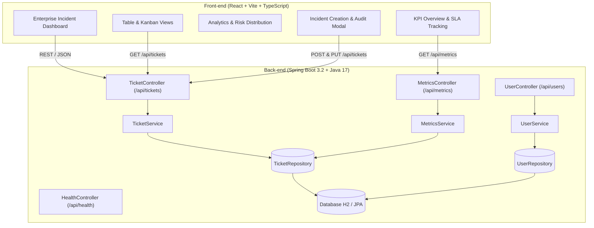

# 🛡️ Homeney — Enterprise Incident & SLA Management (v2.0)

> Sistema corporativo de missão crítica para gestão de chamados, suporte técnico e controle de SLA construído com **Back-end Spring Boot 3 (Java 17)** e interface web **React + Vite + TypeScript (Enterprise Dark Mode)**.


---

## 🏛️ Arquitetura do Sistema



---

## 🎨 Design System & Identidade Visual (Enterprise Dark)

O design foi estruturado com foco em sobriedade e precisão técnica (estilo **Vercel**, **Linear**, **Datadog** e **Grafana Enterprise**):

- **Geometria Estrita**: Bordas retas (`rounded-none` / `rounded-sm`), eliminando raios excessivos e ornamentos supérfluos.
- **Superfícies & Contraste**: Fundo `#0B0C0E` e cartões `#111216` com bordas precisas em `border-zinc-800`.
- **Cores de Estado Funcionais**:
  - **Ações Primárias**: Neutro de alto contraste (`bg-zinc-100 text-zinc-950 hover:bg-white`) e azul corporativo (`#3b82f6`).
  - **Crítico / Urgente**: Vermelho `#ef4444` sólido.
  - **Em Análise**: Âmbar `#eab308`.
  - **Resolvido**: Esmeralda `#22c55e`.
  - **Encerrado / Baixa**: Neutro `#71717a` / `#27272a`.
- **Tipografia**: `Inter` para hierarquia corporativa e `Geist Mono` para números de protocolo, logs e métricas.

---

## 🚀 Funcionalidades Principais

1. **Painel de Métricas & KPIs**:
   - Total de chamados no sistema;
   - Incidentes em atendimento ativo (abertos vs em análise);
   - Alerta visual para incidentes críticos que exigem ação imediata;
   - Taxa de conformidade de SLA em tempo real;
   - Tempo Médio de Resolução (MTTR) em horas.

2. **Gráficos Analíticos (Recharts)**:
   - Volumetria temporal de 7 dias (abertos vs concluídos) com linhas finas e gradientes discretos;
   - Distribuição de risco por nível de severidade e categorias ativas.

3. **Visualização em Tabela & Quadro Kanban (Dual View)**:
   - **Tabela**: Grid corporativo com seleção de status inline, visualização de SLA e controle de exclusão;
   - **Quadro Kanban**: 4 colunas com movimentação ágil de chamados.

4. **Filtros e Busca**:
   - Busca instantânea por protocolo `#0001`, título, descrição ou solicitante;
   - Segmented control de status e dropdowns de severidade e categoria.

5. **Modais e Gestão**:
   - Abertura de chamados com prazos automáticos de SLA por severidade;
   - Inspeção de protocolo com auditoria de timestamps;
   - Gestão e cadastro de operadores e administradores;
   - Alternância de perfil simulado direto no cabeçalho.

---

## 🔌 Documentação da API REST (Swagger)

Acesse a documentação interativa Swagger/OpenAPI em:
👉 `http://localhost:8080/swagger-ui.html`

### Endpoints Principais:

| Método | Endpoint | Descrição |
|---|---|---|
| `GET` | `/api/tickets` | Lista chamados com filtros (`status`, `priority`, `category`, `requester`, `search`) |
| `GET` | `/api/tickets/{id}` | Consulta detalhes de um chamado por ID |
| `POST` | `/api/tickets` | Cria um novo chamado no sistema |
| `PUT` | `/api/tickets/{id}` | Atualização completa de dados |
| `PATCH` | `/api/tickets/{id}/status` | Atualiza status (`Aberto`, `Em Análise`, `Concluído`, `Encerrado`) |
| `PATCH` | `/api/tickets/{id}/priority` | Atualiza prioridade (`Baixa`, `Média`, `Alta`, `Crítica`) |
| `DELETE` | `/api/tickets/{id}` | Remove um chamado |
| `GET` | `/api/metrics` | Retorna KPIs, estatísticas de SLA e volumetria |
| `GET` | `/api/users` | Lista usuários e administradores |
| `POST` | `/api/users` | Cadastra novo usuário |
| `POST` | `/api/auth/login` | Autenticação de operador |
| `GET` | `/api/health` | Status de integridade do servidor |

---

## 💻 Como Executar

### Opção 1: Inicialização Conjunta em 1 Comando (Recomendado)
```bash
./start.sh
# ou:
npm start
```
- **Front-end**: [http://localhost:5173](http://localhost:5173)
- **Back-end**: [http://localhost:8080](http://localhost:8080)
- **Swagger**: [http://localhost:8080/swagger-ui.html](http://localhost:8080/swagger-ui.html)
- **H2 Console**: [http://localhost:8080/h2-console](http://localhost:8080/h2-console)

### Opção 2: Execução Separada
```bash
# Terminal 1 - Back-end:
./mvnw spring-boot:run

# Terminal 2 - Front-end:
cd frontend && npm run dev
```

### Opção 3: Docker Compose
```bash
docker-compose up
```

---

## 🧪 Validação dos Builds

```bash
# 1. Testes e build do Back-end
./mvnw clean test package

# 2. Build de produção do Front-end (TypeScript + Vite)
cd frontend
npm run build
```

---

## 👤 Usuários Padrão para Testes

| Usuário | Senha | Perfil | Permissões |
|---|---|---|---|
| `admin` | `123` | Administrador | Acesso total, prioridades, usuários, deleção |
| `jotape` | `123` | Tech Lead / Admin | Acesso total e resolução de chamados |
| `operador` | `123` | Operador de Suporte | Abertura de chamados, consulta e atualização de status |
