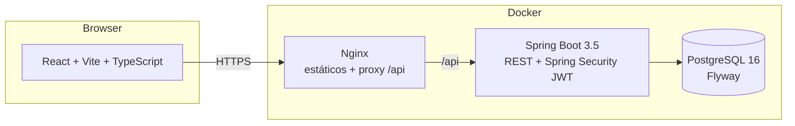

# Homeney — Controle de Chamados

[](https://github.com/Jotape1302/controle-de-chamados/actions/workflows/ci.yml)


Sistema de gestão de chamados de suporte técnico com controle de SLA por prioridade, painel de métricas e visualização em tabela ou Kanban.

Projeto de portfólio full-stack: API REST em **Spring Boot 3** com autenticação **JWT**, banco **PostgreSQL** versionado com **Flyway**, front-end em **React + TypeScript**, testes automatizados e CI no GitHub Actions.

---

## Funcionalidades

- **Autenticação JWT** com senhas em BCrypt e dois perfis de acesso (`ADMIN` e `USER`)
- **Chamados**: abertura, edição, mudança de status e prioridade, exclusão
- **SLA automático** por prioridade (Crítica 2h · Alta 8h · Média 24h · Baixa 72h) com indicação de atraso
- **Painel de métricas**: chamados ativos, críticos, taxa de cumprimento de SLA e tempo médio de resolução (MTTR)
- **Gráficos**: volume de chamados nos últimos 7 dias e distribuição por prioridade/categoria
- **Tabela e Kanban**, com busca e filtros por status, prioridade e categoria
- **Gestão de usuários** (somente administradores)

### Regras de permissão

| Ação | USER | ADMIN |
|---|:-:|:-:|
| Ver, abrir e atualizar status de chamados | ✅ | ✅ |
| Alterar prioridade | ❌ | ✅ |
| Excluir chamado | só os próprios | ✅ |
| Cadastrar usuários | ❌ | ✅ |

As regras são aplicadas **no back-end**; o front-end apenas esconde o que o usuário não pode fazer.

---

## Arquitetura



Organização do back-end (`src/main/java/com/homeney/ticketsystem`):

| Pacote | Responsabilidade |
|---|---|
| `controller` | Endpoints REST e documentação OpenAPI |
| `service` | Regras de negócio e autorização por recurso |
| `repository` | Acesso a dados (Spring Data JPA) |
| `model` / `dto` | Entidades JPA e contratos da API |
| `security` | Configuração do Spring Security, emissão e validação de JWT, CORS |
| `exception` | Tratamento centralizado de erros |
| `config` | OpenAPI, dados de exemplo (dev) e criação do admin inicial (prod) |

---

## Como executar

### Pré-requisitos

- **Desenvolvimento:** JDK 17+ (com `javac`; no Fedora: `sudo dnf install java-25-openjdk-devel`) e Node.js 20+
- **Produção local:** Docker com Docker Compose

### Desenvolvimento (H2 + dados de exemplo)

```bash
./start.sh
```

Ou, em dois terminais:

```bash
./mvnw spring-boot:run            # API em http://localhost:8080 (perfil dev)
cd frontend && npm ci && npm run dev   # Front-end em http://localhost:5173
```

| Serviço | URL |
|---|---|
| Aplicação | http://localhost:5173 |
| Swagger | http://localhost:8080/swagger-ui.html |
| Console H2 | http://localhost:8080/h2-console (JDBC URL: `jdbc:h2:file:./data/homeney-dev`) |

**Usuários de desenvolvimento** (criados automaticamente apenas no perfil `dev`):

| Usuário | Senha | Perfil |
|---|---|---|
| `admin` | `admin123` | ADMIN |
| `jotape` | `jotape123` | ADMIN |
| `operador` | `operador123` | USER |


### Produção local (Docker Compose + PostgreSQL)

```bash
cp .env.example .env
# edite .env: defina POSTGRES_PASSWORD, JWT_SECRET (openssl rand -base64 48) e ADMIN_PASSWORD
docker compose up -d --build
```

A aplicação fica disponível em http://localhost:3000. Na primeira subida, o administrador é criado com `ADMIN_USERNAME`/`ADMIN_PASSWORD`.

### Variáveis de ambiente (perfil `prod`)

| Variável | Obrigatória | Descrição |
|---|:-:|---|
| `DB_URL`, `DB_USERNAME`, `DB_PASSWORD` | ✅ | Conexão com o PostgreSQL |
| `JWT_SECRET` | ✅ | Segredo de assinatura do token (mín. 32 bytes) |
| `JWT_EXPIRATION` | | Validade do token, formato ISO-8601 (padrão `PT8H`) |
| `ADMIN_USERNAME`, `ADMIN_PASSWORD` | | Cria o admin inicial se não houver usuários |
| `CORS_ALLOWED_ORIGINS` | | Origens liberadas, separadas por vírgula (desnecessário atrás do Nginx) |
| `SWAGGER_ENABLED` | | `true` para expor o Swagger em produção (padrão `false`) |

---

## API

Documentação interativa em `/swagger-ui.html` (perfil dev). Todas as rotas, exceto login e health, exigem o header `Authorization: Bearer <token>`.

```bash
# 1. Login
curl -s localhost:8080/api/auth/login -H 'Content-Type: application/json' \
  -d '{"username":"admin","password":"admin123"}'
# => {"accessToken":"eyJ...","tokenType":"Bearer","expiresAt":"...","user":{...}}

# 2. Usar o token
curl -s localhost:8080/api/tickets -H "Authorization: Bearer eyJ..."
```

| Método | Endpoint | Descrição |
|---|---|---|
| `POST` | `/api/auth/login` | Autentica e retorna o token JWT |
| `GET` | `/api/auth/me` | Dados do usuário autenticado |
| `GET` | `/api/tickets` | Lista chamados (filtros: `status`, `priority`, `category`, `requester`, `search`) |
| `GET` | `/api/tickets/{id}` | Detalhes de um chamado |
| `POST` | `/api/tickets` | Abre um chamado |
| `PUT` | `/api/tickets/{id}` | Atualiza um chamado |
| `PATCH` | `/api/tickets/{id}/status` | Altera o status |
| `PATCH` | `/api/tickets/{id}/priority` | Altera a prioridade (ADMIN) |
| `DELETE` | `/api/tickets/{id}` | Exclui (ADMIN ou solicitante) |
| `GET` | `/api/metrics` | KPIs, SLA e volumetria |
| `GET` | `/api/users` | Lista usuários |
| `POST` | `/api/users` | Cadastra usuário (ADMIN) |
| `GET` | `/api/health` | Health check (público) |

Erros seguem um formato único:

```json
{ "timestamp": "...", "status": 400, "error": "Bad Request", "message": "O título é obrigatório.", "errors": { "title": "O título é obrigatório." } }
```

---

## Testes e qualidade

```bash
./mvnw verify                 # back-end: testes de serviço, segurança e contrato de erros
cd frontend
npm run lint                  # ESLint
npm test                      # Vitest + Testing Library
npm run build                 # type-check + build de produção
```

O workflow de [CI](.github/workflows/ci.yml) roda tudo isso em cada push e pull request, além de construir as imagens Docker. O Dependabot mantém as dependências atualizadas.

---

## Licença

[MIT](LICENSE)
